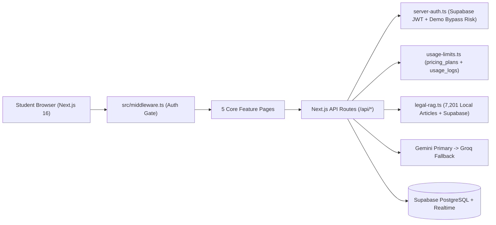

# JURISTIV — MASTER PRODUCT AUDIT, FEATURE ANALYSIS & STRATEGIC REDESIGN

**Product:** Juristiv (`https://www.juristiv.uz/`)  
**Category:** LegalTech + EdTech (Uzbekistan)  
**Audit Mode:** Read-Only Evidence-Based Product, UX/UI, AI, Legal Reliability & Architecture Audit  
**Deliverable Suite:**
1. [JURISTIV_MASTER_PRODUCT_AUDIT.md](file:///g:/Мой%20диск/JURISAI/JURISTIV_MASTER_PRODUCT_AUDIT.md) — Executive Master Report (this document)
2. [FEATURES_DETAILED_ANALYSIS.md](file:///g:/Мой%20диск/JURISAI/FEATURES_DETAILED_ANALYSIS.md) — Deep-dive on all 5 core features
3. [STUDENT_NEEDS_AND_OPPORTUNITIES.md](file:///g:/Мой%20диск/JURISAI/STUDENT_NEEDS_AND_OPPORTUNITIES.md) — Student needs & 10 new feature opportunities
4. [UX_UI_IMPROVEMENT_PLAN.md](file:///g:/Мой%20диск/JURISAI/UX_UI_IMPROVEMENT_PLAN.md) — Page-by-page UX/UI findings & redesign plan
5. [TECHNICAL_ARCHITECTURE_AUDIT.md](file:///g:/Мой%20диск/JURISAI/TECHNICAL_ARCHITECTURE_AUDIT.md) — Full-stack, AI, DB & security audit
6. [MONETIZATION_AND_PRODUCT_STRATEGY.md](file:///g:/Мой%20диск/JURISAI/MONETIZATION_AND_PRODUCT_STRATEGY.md) — Pricing, unit economics & B2B strategy
7. [JURISTIV_IMPLEMENTATION_ROADMAP.md](file:///g:/Мой%20диск/JURISAI/JURISTIV_IMPLEMENTATION_ROADMAP.md) — Prioritized P0–P3 roadmap with acceptance criteria

**Evidence Classification:**
- **VERIFIED**: Directly confirmed in source code, DB migrations, or live `juristiv.uz` browser inspection.
- **PARTIALLY VERIFIED**: Static code/DB evidence confirmed; live authenticated runtime execution not run to avoid mutating production.
- **NOT VERIFIED**: Live production DB row counts and third-party API latency in production.
- **RECOMMENDATION**: Proposed product, educational, UX, or technical improvement.

---

## 1. EXECUTIVE SUMMARY

Juristiv has built an ambitious, genuinely differentiated foundation for legal education in Uzbekistan: **7,201+ local Uzbek code articles** with custom apostrophe-resilient RAG (`src/lib/legal-rag.ts`), an **8-stage procedural Virtual Court** (`src/lib/court/stage-machine.ts`) with WebRTC multiplayer, **verified official document templates** (`src/lib/documents/official-documents-data.ts`), and **IRAC case evaluation** (`src/app/api/ai/irac-evaluate/route.ts`).

However, the audit uncovered **four critical strategic and technical blockers** holding the platform back from daily student adoption and paid conversion:
1. **Severe Security & Data-Integrity Bugs (P0)**: Hardcoded `demo-token-*` auth bypass in `src/lib/server-auth.ts` works in production; `x-guest-id` header spoofing allows impersonation in multiplayer court rooms; `save-analysis/route.ts` overwrites AI IRAC feedback with regex heuristics; and `/api/official-documents/[id]/fill` fails to save user documents due to a server auth bug.
2. **Legal Citation Validation Gap (P0)**: `validateCitations()` exists in `legal-rag.ts` to catch hallucinated article numbers, but is **not wired** into IRAC, Decision Tree, Scenario Generator, or Virtual Court.
3. **Module Overlap & Passive UX (P1)**: *Kazus Yechish* defaults to passive AI solving; *Qarorlar Daraxti* does not let students build/edit their own trees; and *Senariy Generator* overlaps heavily with IRAC and Decision Tree while leaking `is_optimal` answers to the client and sitting outside `middleware.ts` auth protection.
4. **Conversion & Trust Friction on Live Site (P0/P1)**: `/pricing` displays a literal backslash bug (`to \'g \'ri`), a broken 1280px grid, and no link from the homepage; `PaymentNotificationListener` fires `401 /api/payments` on every public page; and Free tier blocks Virtual Court (`0`) and Decision Tree (`0`), hiding Juristiv's strongest differentiators behind a blind paywall.

---

## 2. CURRENT PRODUCT OVERVIEW & 3. ACTUAL SYSTEM ARCHITECTURE (VERIFIED)

- **Frontend:** Next.js `16.3.4` (App Router), React `19.2.4`, Tailwind CSS, TypeScript (`ignoreBuildErrors: true` in `next.config.ts`).
- **Backend API:** Next.js Route Handlers (`src/app/api/**`). A legacy Python FastAPI directory (`backend/`) exists with commented-out routers (`backend/main.py:30`) and zero references from `src/`.
- **Database & Auth:** Supabase (PostgreSQL, Auth, Realtime) accessed via `@supabase/supabase-js` (`src/lib/supabase-admin.ts`). `prisma/schema.prisma` exists but Next.js API routes query Supabase tables directly (`registered_users`, `irac_cases`, `irac_analyses`, `decision_trees`, `court_sessions`, `court_multiplayer_rooms`, `usage_logs`, `pricing_plans`).
- **AI Stack:** Google Gemini primary (`src/lib/gemini.ts`) + Groq fallback (`openai/gpt-oss-120b`, `qwen/qwen3.8-27b`, `llama-3.3-70b-versatile`).

---

## 4. AUDIT METHODOLOGY & LIMITATIONS

- **Codebase Inspection:** Read pages, components, API routes, engines, `legal-rag.ts`, `usage-limits.ts`, `xp-engine.ts`, `server-auth.ts`, `prisma/schema.prisma`, and SQL migrations.
- **Live Website Inspection:** Navigated `https://www.juristiv.uz/` across 8 routes (`/`, `/case-solver`, `/decision-tree`, `/document-generator`, `/virtual-court`, `/scenario-generator`, `/pricing`, `/dashboard`) at desktop and 390px mobile viewports, inspecting network calls, console errors, and screenshots.
- **Limitations (NOT VERIFIED):** No production database credentials were used to inspect live row counts, and authenticated AI generation flows were not executed against production to strictly obey the **report-only / zero production mutation** rule.

---

## 5. INDIVIDUAL ANALYSIS OF ALL FIVE FEATURES (SUMMARY)

*(See [FEATURES_DETAILED_ANALYSIS.md](file:///g:/Мой%20диск/JURISAI/FEATURES_DETAILED_ANALYSIS.md) for full line-by-line analysis.)*

| Feature | Route | Core Verdict | Key Verified Strengths | Key Verified Gaps |
| :--- | :--- | :--- | :--- | :--- |
| **1. Kazus Yechish (IRAC)** | `/case-solver` | **High Value — Needs Targeted Redesign** | Dual mode (`ai_solves` / `user_solves`), 100-pt rubric, RAG grounding, XP tracking | Defaults to passive AI solve; exposes `law_references`; `save-analysis` overwrites AI feedback; no `validateCitations()`; `.txt` export |
| **2. Qarorlar Daraxti** | `/decision-tree` | **Medium Value — Needs Builder Mode** | Visual graph (`DecisionTreeGraph`), path cost/duration simulation, PDF export | No student node/branch editor; no contradiction detection; Guided mode reads like citizen quiz; duplicate `/generate` route |
| **3. Hujjatlar Konstruktori** | `/document-generator` | **High Value — Needs Educational & Export Upgrade** | Verified official catalog (`Oliy Sud`, `LexUZ`), SHA-256 checksum, required-field validation | Exports HTML-as-`.doc`; `/fill` route fails to persist to DB (`user` always `null`); no AI drafting review in UI |
| **4. Virtual Sud** | `/virtual-court` | **Flagship Differentiator — Needs Security & Role Fixes** | Authentic 8-stage JPK/FPK machine, role-weighted AI scoring, multiplayer + WebRTC + STT | `x-guest-id` spoofing vulnerability; in-memory `Map` split-brain risk; no TURN server; civil cases use `PROKUROR` label |
| **5. Senariy Generator** | `/scenario-generator` | **Redundant Standalone — Repurpose as Cross-Feature Engine** | Rich `ScenarioData` schema (`facts`, `evidence`, `timeline`, `legal_issues`) | Unprotected in `middleware.ts`; duplicate templates (`Shablonlar (10)`); `?` overlaps CTA; leaks `is_optimal` to client; overlaps IRAC/Tree |

---

## 6. FUNCTIONALITY VERIFICATION MATRIX

| Capability | Status | Evidence |
| :--- | :--- | :--- |
| **Live Homepage & Pricing** | **VERIFIED** | Accessible HTTP 200; React `#418` hydration error, `401 /api/payments`, and `to \'g \'ri` bug on `/pricing` |
| **Auth Middleware Redirects** | **VERIFIED** | `/case-solver`, `/decision-tree`, `/document-generator`, `/virtual-court`, `/dashboard` redirect to `/signin`; `/scenario-generator` does not |
| **7,201-Article Local RAG** | **VERIFIED** | `src/lib/legal-rag.ts` loads `src/data/full-legal-codes.json` with Levenshtein & stemming |
| **Citation Validation (`validateCitations`)** | **VERIFIED (Partial Wiring)** | Implemented in `legal-rag.ts:918`, called in `document-generate`, **missing** in IRAC/Tree/Scenario/Court |
| **IRAC AI Evaluation & Save** | **PARTIALLY VERIFIED** | Code verified in `irac-evaluate/route.ts` & `save-analysis/route.ts` (bug confirmed: overwrites AI feedback) |
| **Official Document Persistence** | **VERIFIED (Broken)** | `src/app/api/official-documents/[id]/fill/route.ts:52-55` fails to resolve user from request |
| **Virtual Court Multiplayer Sync** | **PARTIALLY VERIFIED** | `multiplayer-db.ts` + `useMultiplayerCourt.ts` verified; split-brain & `x-guest-id` spoofing confirmed in code |

---

## 7. STUDENT NEEDS & 8–9. FEATURE OVERLAP & INTEGRATION ARCHITECTURE

*(Full needs table in [STUDENT_NEEDS_AND_OPPORTUNITIES.md](file:///g:/Мой%20диск/JURISAI/STUDENT_NEEDS_AND_OPPORTUNITIES.md).)*

### Feature Relationship Matrix (VERIFIED & RECOMMENDATION)

| Pair | Relationship | Proposed Integration |
| :--- | :--- | :--- |
| **Senariy Generator ↔ Kazus Yechish** | **High Overlap** (both present legal fact patterns + issues) | Add **"Solve in Kazus Yechish (IRAC)"** button to export generated scenarios into IRAC practice |
| **Senariy Generator ↔ Virtual Sud** | **Complementary** (Scenario creates facts/evidence/participants; Court simulates hearing) | Add **"Launch in Virtual Sud"** button to play any generated scenario in single/multiplayer court |
| **Kazus Yechish ↔ Qarorlar Daraxti** | **Complementary** (IRAC = linear legal argument; Tree = branching strategy/outcomes) | Link IRAC `Rule` articles to Decision Tree nodes; keep UIs strictly distinct |
| **Qarorlar Daraxti ↔ Hujjatlar Konstruktori** | **Complementary** (Tree identifies required procedural action -> Document drafts it) | Add **"Hujjatni tayyorlash"** CTA on terminal Decision Tree nodes (already stubbed in `GuidedDecisionFlow` props) |
| **All 5 Features ↔ Error Tracker & Legal DB** | **Missing Unified Loop** | Feed all scores/mistakes into one **Student Skill Radar** that links weak topics back to `/qonunlar` & IRAC drills |

---

## 10. NEW FEATURE OPPORTUNITIES (TOP 5 OF 10)

*(Full 10-feature specification in [STUDENT_NEEDS_AND_OPPORTUNITIES.md](file:///g:/Мой%20диск/JURISAI/STUDENT_NEEDS_AND_OPPORTUNITIES.md).)*
1. **Adaptive Law Exam & Bar Prep Simulator** (*Imtihon Tayyorgarlik Tizimi*) — P1, highest willingness-to-pay driver.
2. **Personal Error Tracker & Adaptive Learning Path** — P1, drives daily retention across all 5 modules.
3. **Oliy Sud Plenum Rulings & Judicial Practice Analyzer** — P1, essential for upper-year students & advocates.
4. **Juristiv Campus (University & Teacher LMS)** — P1/P3 B2B, leverages existing `Organization` schema.
5. **Document Drafting Coach ("Spot the Flaw" Lab)** — P2, turns Document Generator into a true teaching tool.

---

## 11. UX/UI, 12. LEGAL RELIABILITY, 13. AI & 14. DATABASE/BACKEND SUMMARY

- **UX/UI:** Fix `to \'g \'ri` on `/pricing`, unify `JURISTIV` vs `JURISAI` branding, add `/pricing` to header/footer, fix `/scenario-generator` floating `?` overlap and duplicate templates, and stop `401 /api/payments` polling for guests. *(See [UX_UI_IMPROVEMENT_PLAN.md](file:///g:/Мой%20диск/JURISAI/UX_UI_IMPROVEMENT_PLAN.md).)*
- **Legal Reliability & AI:** Centralize all AI calls through `AIClient` (`ai_response_cache`), wire `validateCitations()` into **every** learning module, and strip `is_optimal`/`xp` from client-side Scenario payloads. *(See [TECHNICAL_ARCHITECTURE_AUDIT.md](file:///g:/Мой%20диск/JURISAI/TECHNICAL_ARCHITECTURE_AUDIT.md).)*
- **Database & Security:** Remove production `demo-token-*` bypass, remove `x-guest-id` spoofing in multiplayer, eliminate `globalThis.__juristivRooms` split-brain state, and remove `ignoreBuildErrors: true`.

---

## 15. MONETIZATION & 16. PRIORITIZED ROADMAP SUMMARY

- **Monetization ([MONETIZATION_AND_PRODUCT_STRATEGY.md](file:///g:/Мой%20диск/JURISAI/MONETIZATION_AND_PRODUCT_STRATEGY.md)):** Unlock 2 free Virtual Court & Decision Tree trials on **Bepul (0 UZS)** so students feel the "aha!" moment; position **Standart (29,000 UZS)** around Exam Prep + IRAC + Error Tracker; align **Pro (79,000 UZS)** with Multiplayer Host, AI Document Review, Plenum Search, and Verified Portfolio (removing paused Marketplace claims); and tighten Pro `FAIR_USE_LIMITS` on STT/Chat to protect gross margins.
- **Roadmap ([JURISTIV_IMPLEMENTATION_ROADMAP.md](file:///g:/Мой%20диск/JURISAI/JURISTIV_IMPLEMENTATION_ROADMAP.md)):** Execute **P0** (Security, Citation Validation, Data Persistence, Live UX bugs) in Week 1 (~8 dev-days), **P1** (Student-First IRAC, Tree Builder, `.docx` + AI Coach, Scenario Engine, Role-Adaptive Court, Tier Rebalance) in Weeks 2–5, and **P2/P3** (Exam Simulator, Error Tracker, B2B Campus) thereafter.

---

## 17. EXPECTED OUTCOMES & 18. DIRECT ANSWERS TO THE 12 STRATEGIC QUESTIONS

1. **Which of the 5 current features are genuinely valuable to law students?**  
   **Virtual Sud** (best-in-class procedural simulator), **Kazus Yechish (IRAC)** (core law-school skill), and **Hujjatlar Konstruktori** (practical clinic/internship skill, once `.docx` and educational annotations are added).
2. **Which features need a complete redesign?**  
   **Senariy Generator** (currently an overlapping multiple-choice quiz with leaked answers) should be redesigned into a dynamic **Cross-Feature Scenario Engine**. **Qarorlar Daraxti** needs a major pivot from a passive AI viewer/citizen quiz into an interactive **Student If/Then Tree Builder**.
3. **Which features only need targeted improvements?**  
   **Kazus Yechish** (flip default to `user_solves`, wire `validateCitations()`, fix `save-analysis`, PDF export), **Hujjatlar Konstruktori** (fix `/fill` auth, real `.docx`, AI drafting coach), and **Virtual Sud** (fix multiplayer security/split-brain, dynamic civil/criminal roles, TURN fallback).
4. **Which features overlap unnecessarily?**  
   **Senariy Generator** overlaps with *Kazus Yechish* (fact patterns + legal issues), *Qarorlar Daraxti* (decision points + consequences), and *Virtual Sud* (participants + evidence). Also, `/api/decision-tree/generate` duplicates `/analyze`, and `backend/` FastAPI duplicates Next.js API routes.
5. **Which features should be integrated?**  
   *Senariy Generator* -> **Kazus Yechish** & **Virtual Sud** (1-click launch); *Qarorlar Daraxti* terminal nodes -> **Hujjatlar Konstruktori**; and **all 5 modules** -> a unified **Personal Error Tracker & Legal Database (`/qonunlar`)**.
6. **Which features are missing?**  
   **Adaptive Law Exam & Bar Prep Simulator**, **Personal Error Tracker**, **Oliy Sud Plenum Rulings**, **University/Teacher LMS (B2B)**, and **Multilingual Legal Terminology (Uz/Ru/En)**.
7. **What should Juristiv's main competitive advantage be?**  
   **Verified Uzbekistan Legal Grounding (7,201+ codes + Plenum rulings + zero-hallucination citation validation) combined with Interactive Procedural Practice (Virtual Court + IRAC Rubric Evaluation)** — something generic ChatGPT cannot reliably deliver in Uzbek law.
8. **What would make students use Juristiv every day?**  
   Daily **5-minute Exam Prep / Kazus Micro-Drills** + a **Personal Error Tracker** showing exam readiness before university midterms/finals, backed by fast, reliable LexUZ/Plenum search.
9. **What would make students genuinely willing to pay?**  
   Measurable outcomes: passing university/bar/magistracy exams (Exam Simulator + Error Tracker), preparing real internship documents (`.docx` + AI review), and hosting team Virtual Court practices.
10. **What should be developed first?**  
    **P0 Security & Integrity fixes** (`server-auth.ts` demo bypass, multiplayer `x-guest-id`, `validateCitations()` across all AI routes, `save-analysis` & `fill` persistence, `/pricing` & `/scenario-generator` live bugs), followed immediately by **IRAC Student-First Mode** and **Adaptive Exam Prep**.
11. **What should not be developed because it adds little value?**  
    Do **not** maintain the unused Python `backend/` server, do **not** keep duplicate `/decision-tree/generate` or `irac-analyze-real` routes, and do **not** add more passive "AI generates text for you" wrappers that let students skip thinking.
12. **What is the most realistic path to making Juristiv a leading legal education platform in Uzbekistan?**  
    **Phase 1 (Trust & Polish):** Fix P0 security, citation validation, and live UI bugs. **Phase 2 (Daily Habit & Conversion):** Launch Adaptive Exam Prep + Student-First IRAC + Free-tier Virtual Court sampling (29,000 UZS Standart). **Phase 3 (B2B Distribution):** Partner with TDYU, UWED, and regional law faculties via **Juristiv Campus** so professors assign Juristiv Kazus and Virtual Court sessions as coursework.
